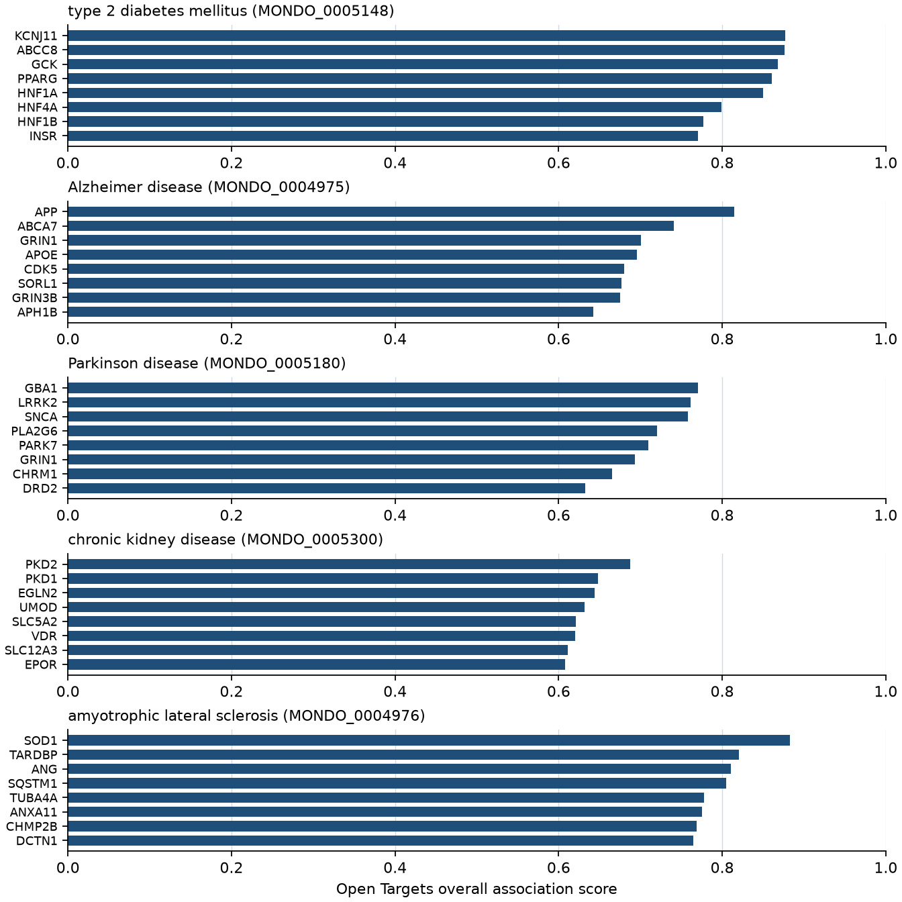

# Disease–Gene Explorer (learning project)

[](LICENSE)

[](https://github.com/Ishitta-Sarkar/disease-gene-explorer/actions/workflows/ci.yml)

A command-line explorer for direct disease–gene associations from the [Open Targets Platform](https://platform.opentargets.org/).

The question it answers is: for type 2 diabetes mellitus, Alzheimer disease, Parkinson disease, chronic kidney disease, and amyotrophic lateral sclerosis, which targets does the Platform rank highest by overall association score, and which EFO disease identifiers and Ensembl gene identifiers are attached to those rows?

## Data

Associations are read from the Platform GraphQL API:

- Endpoint: <https://api.platform.opentargets.org/api/v4/graphql>
- API guide: <https://platform-docs.opentargets.org/data-access/graphql-api>
- Data release used for the results below: **26.09** (released 24 September 2026; [release notes](https://platform-docs.opentargets.org/release-notes), [release announcement](https://blog.opentargets.org/open-targets-platform-26-09-has-been-released/))
- API version reported with that release: 26.9.0

The 26.09 release notes list EFO 3.93.0, MONDO 2026-08-04, and Ensembl 116 among the integrated sources. Disease identifiers are the accessions the API accepts in `disease(efoId:)`. For the five terms below, that accession is a MONDO id inside the EFO disease ontology. Chronic kidney disease also carries the cross-reference `EFO:0003884`. Gene identifiers are Ensembl gene ids. Platform data are dedicated to the public domain under [CC0 1.0](https://platform-docs.opentargets.org/licence).

| Query term | Platform disease id | Direct associations in 26.09 |
| --- | --- | ---: |
| type 2 diabetes mellitus | [MONDO_0005148](https://platform.opentargets.org/disease/MONDO_0005148) | 10206 |
| Alzheimer disease | [MONDO_0004975](https://platform.opentargets.org/disease/MONDO_0004975) | 12918 |
| Parkinson disease | [MONDO_0005180](https://platform.opentargets.org/disease/MONDO_0005180) | 8815 |
| chronic kidney disease | [MONDO_0005300](https://platform.opentargets.org/disease/MONDO_0005300) | 4938 |
| amyotrophic lateral sclerosis | [MONDO_0004976](https://platform.opentargets.org/disease/MONDO_0004976) | 6088 |

These five ids are the top `mapIds` hit for each query term (search score 1.0) on 24 November 2026. They are fixed in `src/disease_gene_explorer/diseases.py`.

Version 0.1 of this repository stored ten hand-written rows in `data/disease_genes.csv`. That file has been removed. The counts and scores in this README come from the query described under Methods.

## Methods

For each disease id the client posts `DiseaseAssociations` and reads:

```graphql
disease(efoId: $efoId) {
  associatedTargets(
    page: {index: 0, size: $size}
    enableIndirect: false
    orderByScore: "score desc"
  ) {
    count
    rows {
      score
      datatypeScores { id score }
      target { id approvedSymbol approvedName biotype }
    }
  }
}
```

`enableIndirect: false` keeps evidence recorded on the queried term. `score` is the Platform overall association score, on a 0–1 scale, using the API's default datasource weights. `datatypeScores` are the per-datatype components of that aggregate (for example `genetic_association`, `literature`, `clinical`). The approved symbol and approved name are the target labels returned by the Platform. The Ensembl id is `target.id`.

Responses are cached as JSON under `cache/opentargets/` (gitignored). The cache key includes the disease id and the page size. `--refresh` replaces a cached file. Tests and the offline command use `tests/fixtures/opentargets_sample.json`, a page-size-3 response for type 2 diabetes mellitus and Alzheimer disease retrieved on the same day. That fixture is the only network substitute committed for the test suite.

The results table and figure were produced by one live call on 24 November 2026:

```bash
python main.py --top 10 --refresh \
  --export results/top_associations.tsv \
  --metadata-out results/query_metadata.json \
  --plot figures/top_association_scores.png \
  --plot-top 8
```

Full-precision scores, datatype scores, and cross-references are in those two results files. Scores printed below are those values rounded to 4 decimal places.

## Quickstart

Python 3.10 or newer. The explorer and the API client use the standard library. Matplotlib is used only for `--plot`. Pytest and Ruff are pinned for tests and CI.

```bash
python -m venv .venv
source .venv/bin/activate
pip install -r requirements.txt

python main.py --input tests/fixtures/opentargets_sample.json
python main.py --input tests/fixtures/opentargets_sample.json --gene APP

python main.py --top 10
python main.py --disease "Parkinson disease"
python main.py --gene APOE
python main.py --disease-id MONDO_0004976 --top 5
```

`python main.py` with no arguments queries the five curated diseases (top 10 each), prints the disease list, summarizes type 2 diabetes mellitus, and searches APOE. The first run needs network access to `api.platform.opentargets.org`. Later runs read the cache.

```bash
ruff check .
ruff format --check .
pytest
```

## Explorer

`DiseaseGeneExplorer` in `src/disease_gene_explorer/explorer.py`:

- `get_all_diseases()`: disease names in the loaded records
- `get_genes_by_disease(disease)`: records for a disease name or disease id, highest score first
- `search_gene(gene)`: records for an approved symbol or an Ensembl id
- `summarize_disease(disease)`: id, release, how many direct associations exist, and the loaded genes with scores

```text
src/disease_gene_explorer/   API client, explorer, plot, CLI
main.py                      entry point
tests/fixtures/              offline GraphQL fixture
results/                     26.09 table and query metadata
figures/                     score chart from that table
```

## Results

The query returned 10 direct associations for each disease (50 rows). The Platform reports thousands of direct associations per term; these are the highest overall scores in release 26.09 under the query above. Across the 50 rows the overall score runs from 0.5842 (NR3C2, chronic kidney disease) to 0.8831 (SOD1, amyotrophic lateral sclerosis).

The figure shows the top 8 of each 10.



The five highest scores in each disease:

**type 2 diabetes mellitus** (`MONDO_0005148`)

| Rank | Gene | Ensembl id | Score |
| ---: | --- | --- | ---: |
| 1 | KCNJ11 | `ENSG00000187486` | 0.8772 |
| 2 | ABCC8 | `ENSG00000006071` | 0.8764 |
| 3 | GCK | `ENSG00000106633` | 0.8680 |
| 4 | PPARG | `ENSG00000132170` | 0.8610 |
| 5 | HNF1A | `ENSG00000135100` | 0.8498 |

**Alzheimer disease** (`MONDO_0004975`)

| Rank | Gene | Ensembl id | Score |
| ---: | --- | --- | ---: |
| 1 | APP | `ENSG00000142192` | 0.8147 |
| 2 | ABCA7 | `ENSG00000064687` | 0.7405 |
| 3 | GRIN1 | `ENSG00000176884` | 0.7008 |
| 4 | APOE | `ENSG00000130203` | 0.6955 |
| 5 | CDK5 | `ENSG00000164885` | 0.6802 |

**Parkinson disease** (`MONDO_0005180`)

| Rank | Gene | Ensembl id | Score |
| ---: | --- | --- | ---: |
| 1 | GBA1 | `ENSG00000177628` | 0.7707 |
| 2 | LRRK2 | `ENSG00000188906` | 0.7617 |
| 3 | SNCA | `ENSG00000145335` | 0.7581 |
| 4 | PLA2G6 | `ENSG00000184381` | 0.7207 |
| 5 | PARK7 | `ENSG00000116288` | 0.7099 |

**chronic kidney disease** (`MONDO_0005300`)

| Rank | Gene | Ensembl id | Score |
| ---: | --- | --- | ---: |
| 1 | PKD2 | `ENSG00000118762` | 0.6875 |
| 2 | PKD1 | `ENSG00000008710` | 0.6478 |
| 3 | EGLN2 | `ENSG00000269858` | 0.6443 |
| 4 | UMOD | `ENSG00000169344` | 0.6313 |
| 5 | SLC5A2 | `ENSG00000140675` | 0.6210 |

**amyotrophic lateral sclerosis** (`MONDO_0004976`)

| Rank | Gene | Ensembl id | Score |
| ---: | --- | --- | ---: |
| 1 | SOD1 | `ENSG00000142168` | 0.8831 |
| 2 | TARDBP | `ENSG00000120948` | 0.8201 |
| 3 | ANG | `ENSG00000214274` | 0.8102 |
| 4 | SQSTM1 | `ENSG00000161011` | 0.8044 |
| 5 | TUBA4A | `ENSG00000127824` | 0.7780 |

## Limitations

- The disease set is the five terms above. It is a fixed learning set, with ids resolved once on 24 November 2026.
- Each call keeps the first page. The association counts in the table are the Platform totals; genes outside the requested page are absent from the explorer until `--top` is raised.
- `enableIndirect` is false, and datasource weights are the API defaults. A different flag or weight changes both the count and the order.
- The overall score is the Platform's aggregate of datatype scores for that release. Datatype scores are stored in `results/top_associations.tsv`.
- Approved names are the labels returned by the Platform for Ensembl 116 in this release.
- A later Platform release can change scores, labels, and counts. Re-run with `--refresh` and record `data_version` from the metadata file.

## Citation

Software citation metadata is in [CITATION.cff](CITATION.cff).

For the Platform data, cite the publication requested in the [Open Targets citation guide](https://platform-docs.opentargets.org/citation): Buniello, A. et al. (2025). Open Targets Platform: facilitating therapeutic hypotheses building in drug discovery. *Nucleic Acids Research.* State the data release (here, 26.09) with the citation.

## Author

Ishitta Sarkar · [ORCID 0009-0008-1028-6010](https://orcid.org/0009-0008-1028-6010)

M.Tech in Bioinformatics (in progress, expected 2028). B.Tech Biotechnology (Honours), Dr. A.P.J. Abdul Kalam Technical University, 2022–2026.

MIT License. See [CHANGELOG.md](CHANGELOG.md).

## Roadmap

- [x] Associations from the Open Targets Platform GraphQL API, with overall and datatype scores
- [x] Ensembl gene ids and EFO/MONDO disease ids
- [ ] A second public source, such as DisGeNET or the Ensembl REST API
- [ ] Feed the same association records into [SANJIVANI](https://github.com/Ishitta-Sarkar/sanjivani-evidence-graph)
